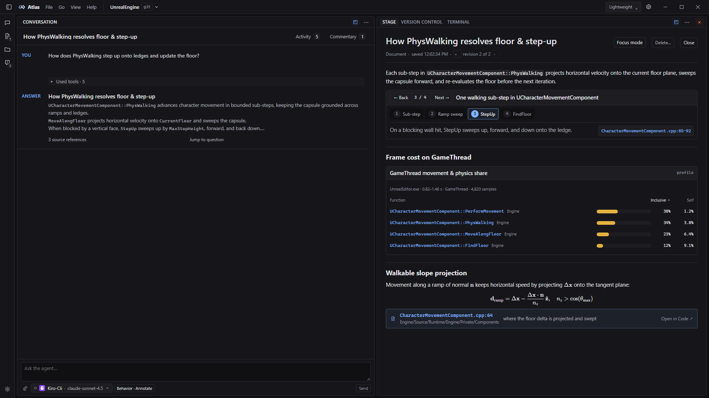
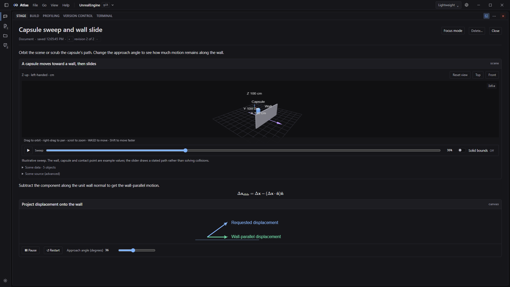
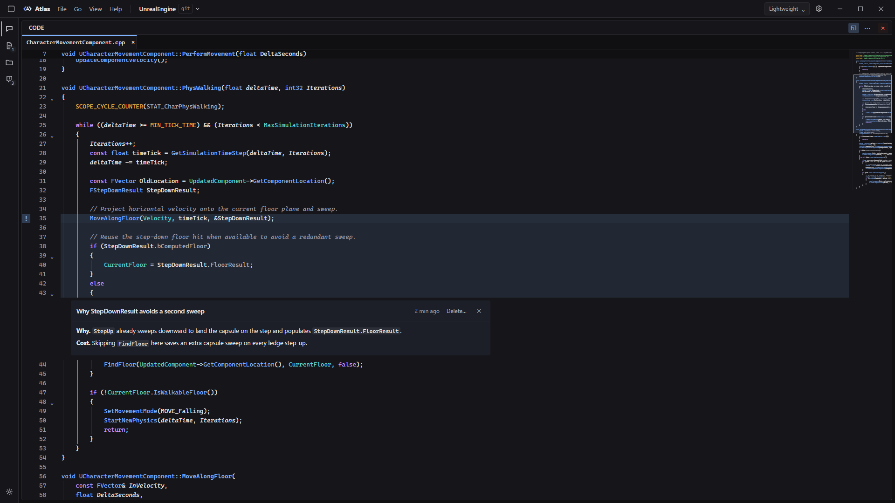
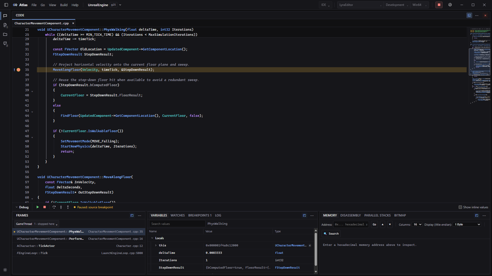
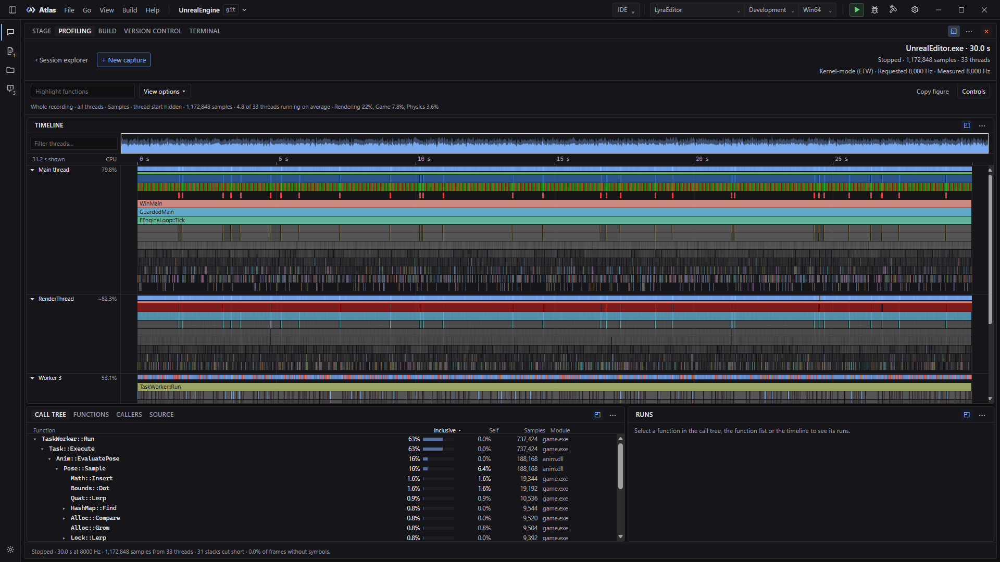

#  Atlas

**A C++ IDE for focused agentic development.**

Edit, build, debug, and profile C++ on Windows. Give coding agents focused
tasks and follow their findings back to source. Atlas works with Unreal Engine projects, Visual Studio solutions, and
standalone C++ repositories.

[**Download for Windows**](https://github.com/papsop/atlas-releases/releases/latest) ·
[Preview builds](https://github.com/papsop/atlas-releases/releases) ·
[Tutorials](https://atlas.patrikpapso.com/tutorials.html) ·
[Report an issue](https://github.com/papsop/atlas-releases/issues/new/choose) · [Join the Atlas Discord](https://discord.gg/7n4MWTWdrN)

## Conversation and Stage

Ask a coding agent how a system works, then explore its findings on Stage. A workspace document can bring together interactive walkthroughs, figures, and links back to source.

## Visual documents

Combine an orbitable 3D scene, an interactive canvas, and typeset equations in
one document. This example uses all three to explain how a capsule slides
along a wall.

## Code annotations

Keep an explanation anchored to the lines it describes so you can read it in
context the next time you open the file.

## Debugger and Code

Pause at a breakpoint, follow the call stack, and inspect local variables
alongside the source.

## CPU profiler

Follow CPU activity across threads and use the call tree to see where time goes.
[Try the interactive profile example](https://atlas.patrikpapso.com/profiler-showcase/index.html).

*Screenshots show Atlas's interface with a fictional showcase workspace, simulated
debugger state, and a generated CPU profile.*

## Install

Download `Atlas_<version>_x64-setup.exe` from the
[latest stable release](https://github.com/papsop/atlas-releases/releases/latest).
Run the installer, launch Atlas, and open a project folder.

- **Windows x64** with WebView2 (included with Windows 11).
- **Build and debug** with your project's tools, such as Visual Studio or Unreal
  Engine, and debug symbols. Atlas bundles the debugger runtime.
- **Connect an agent** by installing and signing in to an ACP-compatible agent.

Atlas checks for signed updates in **Settings**. Turn on **Get preview builds**
to receive pre-releases.

Atlas is proprietary software, free to use during the public beta.
[License terms and bundled open-source components](https://atlas.patrikpapso.com/license.html).
